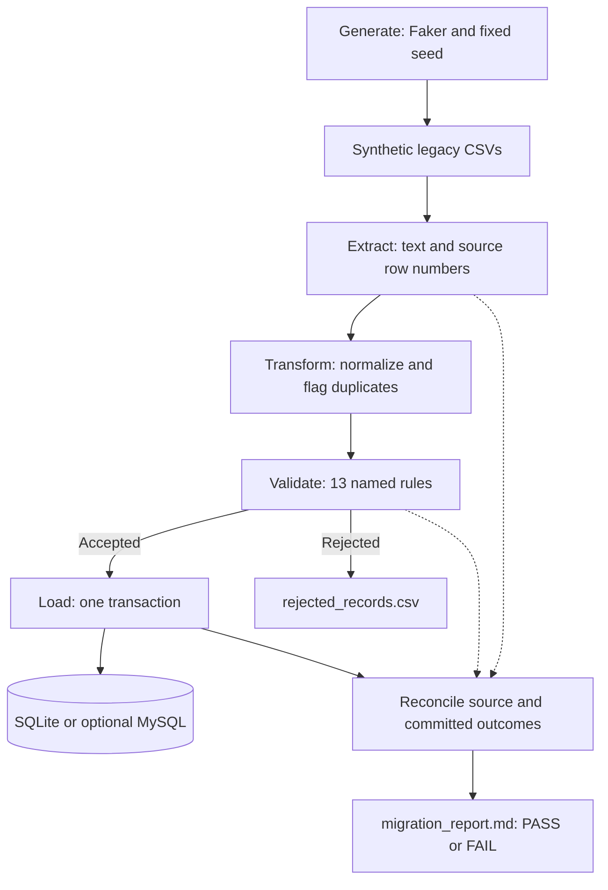

# Loan Portfolio Data Migration & Data Quality Pipeline

Migrate messy **synthetic** customer, loan, and payment CSVs into a normalized
SQL database, with named validation rules, auditable rejections, and a
reconciliation report that accounts for every source record.

- **Explainable quality checks:** 13 rules cover missing fields, duplicates,
  invalid values, orphan references, and payment chronology.
- **Safe repeat loads:** all new rows load in one transaction; identical existing
  records are confirmed, while changed IDs stop the load.
- **Easy local demo:** SQLite needs no database server. Three commands generate
  data, run the migration, and display the report.

All eight implementation phases are complete. The personal reflection at the
end remains for the project owner to write.

## Why I built it

I am a Business Informatics student preparing for data-related internships,
including data migration roles. I built this project to demonstrate how I
approach legacy data cleanup, relational integrity, and source-to-target
reconciliation, with decisions a reviewer can inspect and I can explain.

Every business record is generated by a script. Valid-looking emails use
`example.com`; no real customer or company data is used.

## Example result

Default input: **1,000 base customers, seed 42**. The generator adds intentional
duplicates and creates 1,000 loans and 2,000 payments. The report contains:

**Overall status: PASS**

| Table | Read | Cleaned | Rejected | Loaded | Check |
| --- | ---: | ---: | ---: | ---: | --- |
| customers | 1100 | 1050 | 450 | 650 | PASS |
| loans | 1000 | 1000 | 500 | 500 | PASS |
| payments | 2000 | 2000 | 1050 | 950 | PASS |
| **Total** | **4100** | **4050** | **2000** | **2100** | **PASS** |

The equation is **read = loaded + rejected**, checked for each table. Cleaned
is the intermediate count after exact duplicate removal. Removed duplicates
are included in rejected records. A PASS means complete accounting, even when
the intentionally messy source contains invalid data.

The report also groups rejections by their first failed rule. Selected examples:

| Table | Primary rule | Rejected records |
| --- | --- | ---: |
| customers | `VR001_INVALID_EMAIL` | 50 |
| customers | `VR013_EXACT_DUPLICATE` | 50 |
| loans | `VR010_CUSTOMER_NOT_FOUND` | 350 |
| payments | `VR012_PAYMENT_BEFORE_LOAN_START` | 50 |

The full breakdown accounts for 2,000 rejected records. A record with several
violations contributes once. On the first load, 2,100 rows are inserted. A repeat
load inserts **0**, confirms **2,100 already present**, and keeps the same totals.

## Architecture



The target model is **customers → loans → payments**: each loan references one
customer, and each payment references one loan. Primary keys, foreign keys,
required fields, unique customer emails, and amount/status constraints are
defined in [sql/schema.sql](sql/schema.sql).

## Tech stack

Python 3.11+, pandas, SQLAlchemy Core, SQLite, Faker, pytest, and ruff.
`python-dotenv` reads configuration, `pycountry` supplies ISO country codes, and
PyMySQL provides the optional MySQL driver. No application framework is needed.

## Run it step by step

Prerequisites: Git and Python 3.11+. Run commands from the repository root.
For the complete Windows/VS Code walkthrough, including tool installation and
troubleshooting, use [docs/RUNBOOK.md](docs/RUNBOOK.md).

### 1. Get the repository

```text
git clone https://github.com/gig0d/loan-portfolio-data-migration.git
cd loan-portfolio-data-migration
```

If this checkout already exists, keep it and skip cloning.

### 2. Create the environment and install dependencies

Windows PowerShell:

```powershell
if (-not (Test-Path .venv/Scripts/python.exe)) { python -m venv .venv }
.\.venv\Scripts\python.exe -m pip install -r requirements.txt
if (-not (Test-Path .env)) { Copy-Item .env.example .env }
```

If Python is available through the Windows launcher, use `py -3 -m venv .venv`
when creating the environment. Calling its interpreter directly requires no
activation or execution-policy change.

macOS / Linux:

```bash
python3 -m venv .venv
.venv/bin/python -m pip install -r requirements.txt
if [ ! -f .env ]; then cp .env.example .env; fi
```

The editable installation supports the `src` layout without setting `PYTHONPATH`.
Keep the default SQLite URL in `.env`; no server or credentials are required.

### 3. Generate, migrate, and read the report

Run these commands one at a time in PowerShell:

```powershell
.\.venv\Scripts\python.exe -m migration.cli generate
.\.venv\Scripts\python.exe -m migration.cli run
.\.venv\Scripts\python.exe -m migration.cli report
```

On macOS / Linux, use `.venv/bin/python` in place of
`.\.venv\Scripts\python.exe`.

| Command | Action |
| --- | --- |
| `generate` | Replace the three synthetic legacy CSVs using the configured size and seed |
| `run` | Extract, transform, validate, load, and write the reconciliation report |
| `report` | Display the saved report without connecting to the database or refreshing it |

Run `run` a second time to verify that it inserts zero duplicate rows. If an
existing ID has changed values, the load fails and rolls back all new rows.
Choose a **new database filename** before migrating a different seed or snapshot.

### 4. Inspect the local outputs

With the default configuration, `data/output/` contains:

| File | Purpose |
| --- | --- |
| `loan_portfolio.db` | SQLite tables with accepted records |
| `customers_valid.csv`, `loans_valid.csv`, `payments_valid.csv` | Accepted records for inspection |
| `rejected_records.csv` | One rejected source record per row: rule, reason, all violations, and original payload |
| `migration_report.md` | Counts, inserted/existing outcomes, rule breakdown, and PASS/FAIL diagnostics |

Open the Markdown report in VS Code and press **Ctrl+Shift+V** to preview it.
The [SQL walkthrough](docs/RUNBOOK.md#9a-phase-5-create-load-and-inspect-sqlite)
shows how to query the database. Generated data, reports, databases, `.env`, and
the virtual environment stay ignored by Git; a tiny synthetic sample is tracked
under [data/legacy/sample/](data/legacy/sample/).

### 5. Run the checks

```powershell
.\.venv\Scripts\python.exe -m pytest
.\.venv\Scripts\python.exe -m ruff check .
.\.venv\Scripts\python.exe -m ruff format --check .
.\.venv\Scripts\python.exe -m pip check
```

Tests cover transformation functions, all named validation rules, SQL integrity,
rollback, repeat loading, reconciliation failures, and CLI subprocesses. The
optional live MySQL test is skipped unless an empty test database is supplied.

## Configuration and CLI options

Precedence: **command flags → shell environment → `.env` → defaults**.
See [.env.example](.env.example) for safe examples.

| Variable | Default |
| --- | --- |
| `DATABASE_URL` | `sqlite:///data/output/loan_portfolio.db` |
| `LEGACY_DATA_DIR` | `data/legacy` |
| `OUTPUT_DATA_DIR` | `data/output` |
| `SCHEMA_PATH` | `sql/schema.sql` |
| `CUSTOMER_COUNT` | `1000` base customers |
| `RANDOM_SEED` | `42` |
| `LOG_LEVEL` | `INFO` |

Use `generate --customers 1000 --seed 42` for explicit generation parameters.
`--size` aliases `--customers`. `run` accepts `--input-dir`, `--output-dir`, and
`--schema-path`; `report` accepts `--output-dir`. All commands accept
`--log-level` and `--help`.

Configured relative paths resolve from the repository root; explicit relative
path flags resolve from the working directory. Logs use standard error; `report`
writes Markdown to standard output. Exit codes are `0` for success/PASS, `1` for
FAIL or an operational error, and `2` for invalid usage.

## Data quality and load decisions

- The generator injects three date formats, spelling/casing variants, missing
  values, invalid emails/countries, currency-formatted amounts, orphan loans,
  negative or early payments, and inconsistent statuses. These are controlled
  fixtures, not estimates of real-world data quality. Generation is reproducible
  for the same size, seed, and pinned Faker version.
- Exact duplicates retain one source occurrence; removed copies are rejected.
  Conflicting IDs and all members of probable shared-email customer groups are
  rejected for review. No automatic identity merge is performed.
- Accepted loans require accepted customers, and accepted payments require
  accepted loans. Email/country checks and payment chronology run in Python.
  See the [13-rule catalog](docs/VALIDATION_RULES.md).
- Money is parsed as `Decimal` and stored as integer cents: `1200.50` becomes
  `120050`. The loader refuses rounding, overflow, and oversized text.
- All new portfolio rows load in one transaction. Schema creation happens
  beforehand; empty tables can remain after a failed load. Existing schemas
  are not upgraded. Reports publish committed outcomes, with an incomplete FAIL
  marker while an attempt is running.

`run` writes accepted/rejected outputs and the report. For intermediate cleaned
CSVs and duplicate/conversion diagnostics, use the standalone transformation
command in [runbook step 8](docs/RUNBOOK.md#8-phase-3-transform-and-inspect-diagnostics).

SQLite is tested locally. MySQL is selectable through `DATABASE_URL` and requires
MySQL 8.0.16+ with InnoDB, but has **not been verified against a live server** in
this workspace. Follow the [optional MySQL setup](docs/RUNBOOK.md#9b-optional-mysql-route-separate-server-required)
before attempting it. Reconciliation confirms this run's source accounting,
rather than independently auditing concurrent changes to the whole database.

## Project structure

```text
loan-portfolio-data-migration/
├── README.md
├── AGENTS.md
├── requirements.txt
├── pyproject.toml
├── .env.example
├── .gitignore
├── docs/
│   ├── DESIGN.md                 # Decisions recorded by phase
│   ├── RUNBOOK.md                # Complete owner walkthrough
│   └── VALIDATION_RULES.md       # Rules and rejection CSV contract
├── data/
│   ├── legacy/sample/            # Tiny tracked synthetic CSVs
│   └── output/                  # Ignored reports and database
├── src/migration/
│   ├── generate_legacy_data.py
│   ├── extract.py
│   ├── transform.py
│   ├── validate.py
│   ├── load.py
│   ├── reconcile.py
│   ├── cli.py
│   └── config.py
├── sql/schema.sql
└── tests/                       # Unit, database, reconciliation, and CLI tests
```

Implementation followed eight reviewable phases: setup, generation, cleanup,
validation, loading, reconciliation, CLI/tests, and documentation. Detailed
tradeoffs are recorded in [docs/DESIGN.md](docs/DESIGN.md).

## What I learned

TODO: I will write this section myself, in my own words, after reviewing and
running the project.
